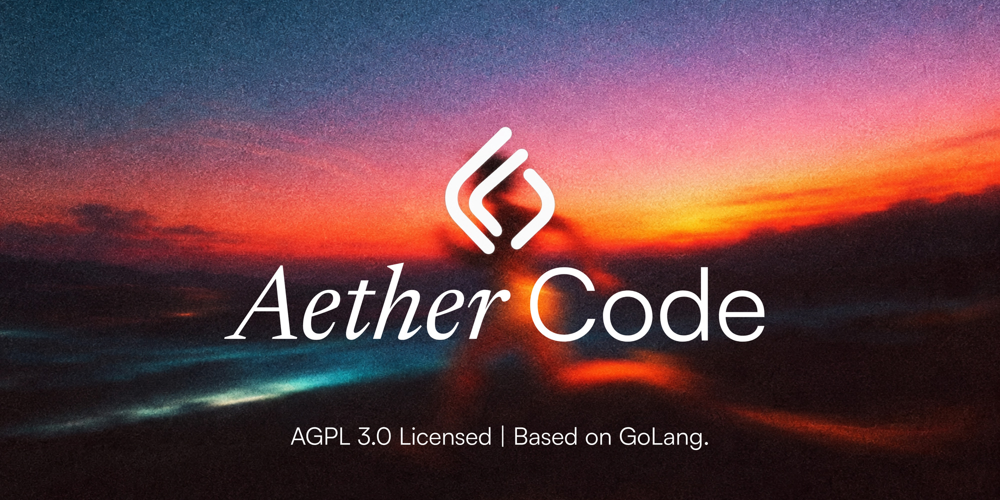

<p align="center">
  
</p>

# AetherCode

[](LICENSE)

AetherCode is an open-source coding-assessment platform for colleges. Staff
write programming questions with hidden tests, students sit timed exams in a
HackerRank-style editor (optionally locked down in Safe Exam Browser), and
submissions are compiled and judged in a sandboxed execution engine. Around the
exams it gives students practice problems, interview experiences, contest and
hackathon listings, and gives staff results, live monitoring and analytics.

It is built for supervised college lab exams and released under the
[GNU AGPL v3](LICENSE).

## What it does

**Students**
- Sit exams in the browser: Run on samples, custom input, Submit per question,
  autosave, a server-owned timer and auto-submit at time-up.
- See released results with per-test verdicts, their progress and a practice
  catalogue.
- Read approved interview experiences and blogs, browse and save contests,
  hackathons and open-source issues, link coding accounts, keep a task list.

**Faculty and administrators**
- Import students from CSV, manage departments, batches, placement departments,
  staff accounts and roles.
- Author coding and multiple-choice questions with sample and hidden tests;
  a model solution must pass every test before a question is published, and an
  optional second reviewer can be required.
- Build exams with question pools, assign them to batches, departments or
  placement departments, lock them to Safe Exam Browser and lab networks.
- Run the exam day: live monitor, announcements, extra time, regrading,
  results release, CSV export, similarity report, audit log, analytics, an exam
  calendar and a "try as a student" preview.
- Approve interview experiences, write blogs and keep listings current.

## Architecture in brief

Multi-tenant Go microservices (gateway, identity, tenant, user, question-bank,
assessment, submission, judge, seb, notification, analytics), each with its own
PostgreSQL database under forced row-level security and signed, five-second
authorization capabilities. Services talk over NATS JetStream with a
transactional outbox. Code runs in the isolated AetherCode Execution Engine,
reached only through the judge service. The web UI is a Next.js backend-for-
frontend that holds sessions in cookies and calls the gateway; it has no
database. Diagram: [docs/architecture](docs/architecture/ARCHITECTURE_DIAGRAM.md).

## Repository layout

| Path | Contents |
|---|---|
| `backend/services/` | The eleven Go services (hexagonal: `app`, `adapters`, `migrations`, `api`) |
| `backend/libs/pkg/`, `backend/libs/proto/` | Shared platform packages; gRPC contracts (source of truth) |
| `backend/scripts/` | Migration, key-provisioning and verification scripts |
| `frontend/` | The Next.js web UI for students and staff ([README](frontend/README.md)) |
| `deploy/single-server/` | The Docker Compose stack the campus runs ([README](deploy/single-server/README.md)) |
| `deploy/helm/`, `deploy/kustomize/`, `deploy/compose/`, `deploy/database/` | Kubernetes charts, overlays, judge control-plane and database provisioning |
| `apps/exam-v1/` | The frozen v1 exam app, a fallback until cut-over ([README](apps/exam-v1/README.md)) |
| `docs/` | [Index](docs/README.md), [ADRs](docs/adr/README.md), [platform guide](docs/platform-guide.md), runbooks, [roadmap](docs/roadmap.md) |
| `PLAN.md` | Service ownership, topology, retention and promotion requirements |

The platform and v1 share no code or database. The split is recorded in
[ADR-0016](docs/adr/0016-lean-exam-app-for-first-launch.md) and
[ADR-0017](docs/adr/0017-go-platform-as-the-only-backend.md).

## Getting started

**Deploy on one server** (what the campus runs): follow
[deploy/single-server/README.md](deploy/single-server/README.md): setup,
first administrator, public address, backups, single sign-on, branding and the
release checklist.

**Develop locally**

```sh
# prerequisites: Go 1.26.7, Node 24 with pnpm 12, Docker
make dev-up                 # PostgreSQL and NATS for the platform profile
make build test             # all Go modules
make web-check web-build    # the web UI: typecheck, lint, tests, build
make test-integration       # Testcontainers-backed; needs Docker
make lint                   # golangci-lint
make migrate SVC=identity DIR=up
```

`make dev-judge-up` starts the isolated judge control plane from an untracked
`.judge-control.env`; it does not start the execution engine. The full command
list and rules for contributors, human or automated, are in
[AGENTS.md](AGENTS.md).

## Documentation

- [Documentation index](docs/README.md) and [platform guide](docs/platform-guide.md)
  (security model, judge boundary, first run, key rotation)
- [Roadmap](docs/roadmap.md): what is done, what is pending, production gates
- [Architecture decision records](docs/adr/README.md)
- [Runbooks](docs/runbooks/judge-control-operations.md) and the
  [single-server guide](deploy/single-server/README.md)

## Status

The platform is the only backend going forward. Exams still run on v1 until the
stack-level checks in the roadmap pass on the campus server: the browser spec,
the engine check and a 1000-student load test. Production gates that need
outside systems (HA PostgreSQL, KMS, notification provider, engine isolation
evidence) are listed in the roadmap.

## Contributing

Contributions are welcome: read [CONTRIBUTING.md](CONTRIBUTING.md) first, and
follow the [Code of Conduct](CODE_OF_CONDUCT.md). Report security issues
privately as described in [SECURITY.md](SECURITY.md), never in a public issue.

## License

Copyright (C) 2026 St. Joseph's Group of Institutions.

AetherCode is free software: you can redistribute it and/or modify it under the
terms of the [GNU Affero General Public License v3.0](LICENSE). If you run a
modified version as a network service, the AGPL requires you to offer its
users the corresponding source code. See [NOTICE](NOTICE).
